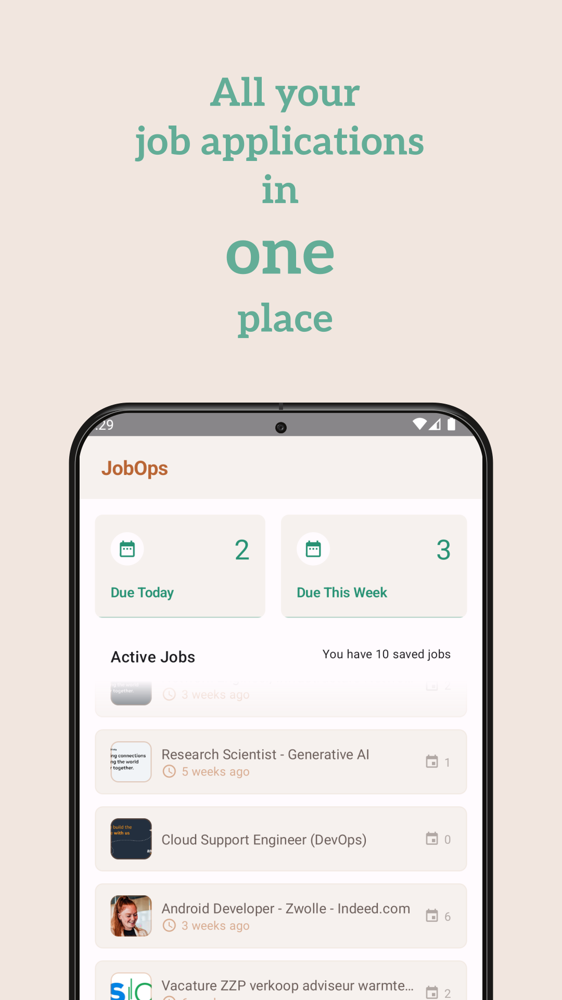
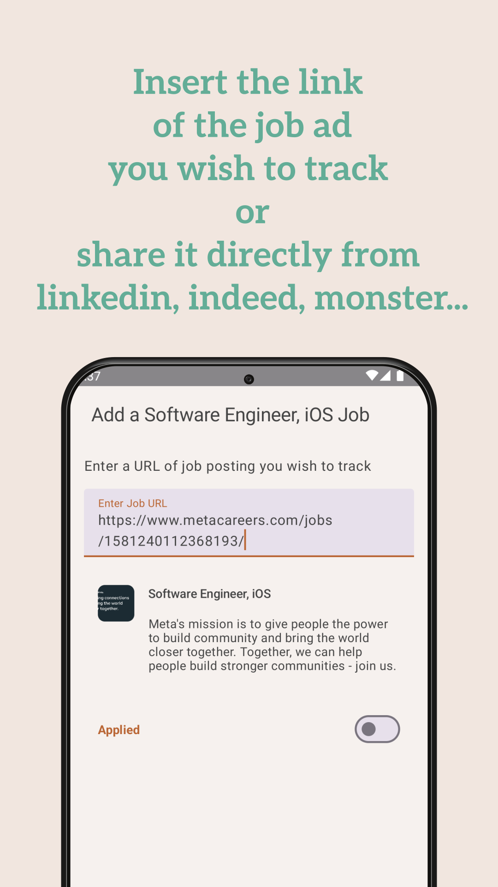
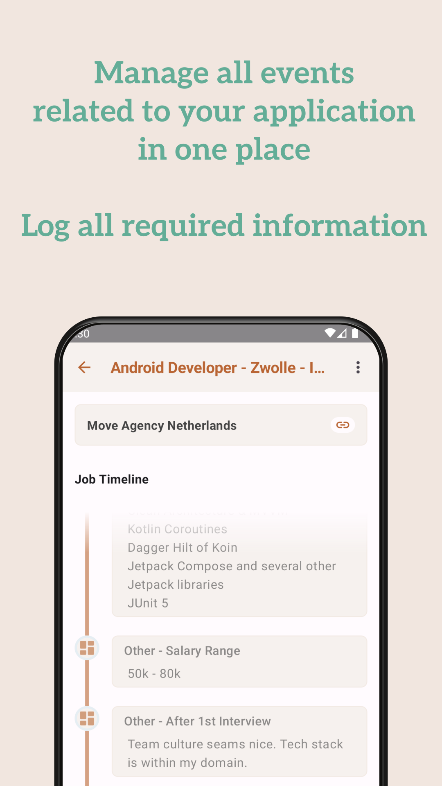

# JobOps for Android

JobOps is a native Android app for keeping job applications, follow-ups, interviews,
assignments, and offers in one private, local-first timeline.

<p align="center">
  
  
  
</p>

## Features

- Save a vacancy from its URL and keep the role, company image, notes, and priority together.
- Record application events: applied, interview, assignment, offer, or a custom event.
- See what is due today and during the current week.
- Review each application's event history as a timeline.
- Archive closed applications without losing their history.
- View monthly application statistics.
- Choose between app themes and configure reminder notifications.

## Architecture

JobOps uses a single-activity, reactive architecture:

- Jetpack Compose screens observe state exposed by Hilt-injected view models.
- Repository and local data-source layers separate UI state from persistence.
- Room stores jobs and their related events on-device.
- DataStore persists app preferences.
- WorkManager schedules reminder notifications.
- Compose Destinations provides typed navigation.

The main source lives under
[`app/src/main/java/com/frontmatic/sendwrite`](app/src/main/java/com/frontmatic/sendwrite),
organized into `ui`, `repository`, `local`, `worker`, and `di` packages.

## Stack

- Kotlin and Kotlin coroutines/Flow
- Jetpack Compose with Material 3
- Room and DataStore
- Hilt dependency injection
- WorkManager
- Compose Destinations
- Coil and OpenGraphParser
- Gradle Kotlin DSL and version catalogs

## Build

Requirements:

- Android Studio Ladybug or newer
- JDK 17
- Android SDK 35

Clone the repository and build the debug APK:

```bash
git clone git@github.com:frontmesh/jobops-android.git
cd jobops-android
./gradlew assembleDebug
```

The APK is written to `app/build/outputs/apk/debug/`.

### Release signing

No signing key or password is stored in this repository. Supply all four values as
Gradle properties (for example in your user-level `~/.gradle/gradle.properties`) or
as environment variables:

```properties
JOBOPS_RELEASE_STORE_FILE=/absolute/path/to/your-release-key.jks
JOBOPS_RELEASE_STORE_PASSWORD=your-store-password
JOBOPS_RELEASE_KEY_ALIAS=your-key-alias
JOBOPS_RELEASE_KEY_PASSWORD=your-key-password
```

Then run:

```bash
./gradlew bundleRelease
```

If the signing values are absent, debug builds continue to work and the release
variant is generated unsigned.

## License

JobOps is available under the [MIT License](LICENSE).
